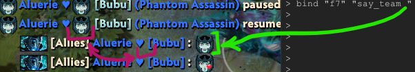

# 😳 ListEmoticons

Updated fork of [ListEmoticons.ipynb](https://github.com/rossengeorgiev/dota2_notebooks/blob/master/List%20Emoticons.ipynb) by [@rossengeorgiev](https://github.com/rossengeorgiev). Maintained by [@Aluerie](https://github.com/Aluerie).

---

Search for an emoticon on the page and click it to copy its character, then paste it:

* into console for such binds as `bind o "say_team "` - this one is `:pa_kiss:`.  
* into your nickname - note that in this case emoticons will only show up in system-messages such as "Player paused the game". They will not show in chat, kill-feed or anywhere else really, only system messages.



It doesn't matter if you don't own the emoticon pack.

## 📋 Table of Dota 2 Emoticons

You can find the table with all emoticons here:

## 🔗 [aluerie.github.io/Dota2Utils/ListEmoticons](https://aluerie.github.io/Dota2Utils/ListEmoticons)

🤖 The table updates itself: every week a [GitHub Actions workflow](../.github/workflows/emoticons.yml) checks Dota 2 for new emoticons and opens a PR with them. If it's still outdated, hit me up with an issue or PR.

## 🔄 Updating the table

1. Follow the setup in the [main README](../README.md#-setup) and set the Source 2 Viewer CLI path under `[list_emoticons]` in `config.toml`.
2. Run:

```sh
uv run ListEmoticons
```

It reads the emoticons from your Dota 2 install, creates gifs for new ones in [docs/ListEmoticons/gifs/](../docs/ListEmoticons/gifs/) and rebuilds the table in [docs/ListEmoticons/index.md](../docs/ListEmoticons/index.md). If nothing is new, it changes nothing.

## ☁️ Without Dota 2 installed

`--from-steam` downloads just the needed files from Steam instead (the 23 MB VPK index plus the new textures, not the whole game):

```sh
uv run ListEmoticons --from-steam
```

It needs a Steam account with Dota 2 in its library (anonymous Steam accounts can't download Dota files) and **Steam Guard turned off**, since nobody is there to type a code in CI. Use a throwaway account: its password ends up in GitHub secrets.

- For local runs, put the login under `[list_emoticons]` in `config.toml`:

  ```toml
  steam_username = "throwaway_login"
  steam_password = "..."
  ```

- For the weekly workflow, save the same as GitHub secrets (each command asks you to paste the value):

```sh
gh secret set STEAM_USERNAME
```

```sh
gh secret set STEAM_PASSWORD
```
